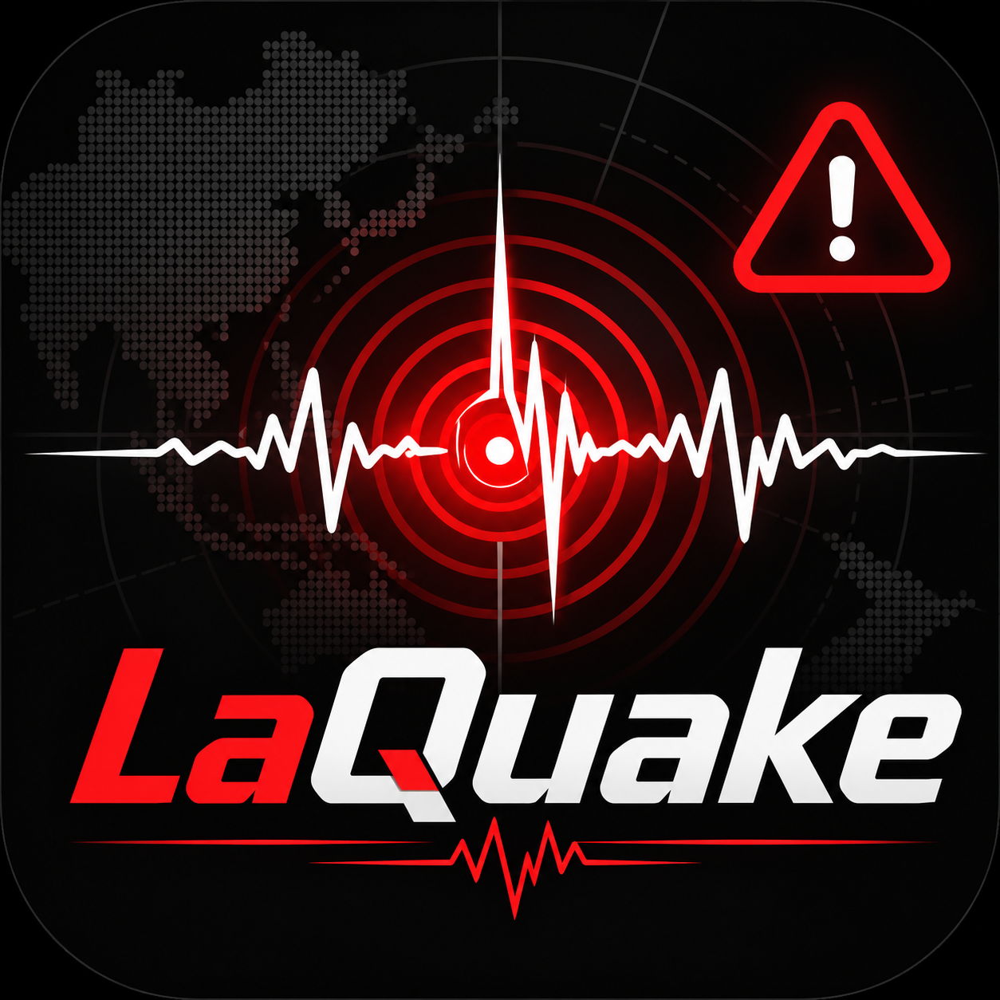

<div align="center">



# LaQuake 地震早期警戒・速報

**Electron ベースの Windows デスクトップ向け地震早期警戒（EEW）・速報ソフト**

[简体中文](README.md) · [繁體中文](README.zh-TW.md) · [English](README.en.md) · 日本語 · [한국어](README.ko.md)

[](https://github.com/Latte0903/LaQuake/releases/latest)
[](https://github.com/Latte0903/LaQuake/releases)

</div>

---

LaQuake は Windows 向けの地震早期警戒受信・強力な通知ツールです。[Wolfx (Wolfx.jp)](https://wolfx.jp/) を主要なデータソースとし、地震波が到達する前にタイムリーで目立つ警戒情報をお届けすることを目指しています。発生後の詳細な地震速報のプッシュにも対応しています。


## 🌟 主な機能

- **リアルタイムデータ受信：** Wolfx API から地震早期警戒（EEW）と地震速報をミリ秒単位で受信します。
- **全画面の強い通知：** 設定したしきい値に達すると、常に最前面に表示される全画面ポップアップと警報音で重要な情報を見逃しません。
- **警戒シミュレーション：** 防災訓練、教育デモ、ソフト設定のテスト用に、EEW の模擬機能を内蔵しています。
- **エコシステム連携：** [EEWCN](https://www.bilibili.com/video/BV1Zs4y1g7un/) と組み合わせて、より包括的な防災情報モニタリングを構築できます。
- **モダンな UI：** Electron 製で、シンプルで滑らかなインターフェースと低いシステム負荷を実現しています。

## 💻 動作環境

- OS：Windows 10 / Windows 11（64 ビット）
- ネットワーク：リアルタイムデータを受信するため、常時インターネット接続が必要です。

## ⚠️ 重要な表明と免責事項（必読）

本ソフトのご利用または本リポジトリのソースコードの閲覧の前に、以下の条項をよくお読みください。本ソフトを使用することで、以下のすべてに同意したものとみなされます。

- **アルファ版についての同意：** 本ソフトは現在アルファ初期テスト段階にあり、不安定さ、機能の不完全さ、クラッシュ、データ表示の異常などが発生する可能性があります。開発者は、ソフトの不具合や動作停止によって生じる直接的・間接的な結果について責任を負いません。
- **非営利・寄付お断りの表明：** 本ソフトは完全無料の個人の学習・研究プロジェクトであり、いかなる形式の支払い、スポンサー、会員費、寄付も受け付けません。いかなる経路であれ、有償版、有償ビルド代行、投げ銭を求めるものは詐欺ですので、ご注意ください。
- **著作権とライセンスの制限：** 本プロジェクトには現時点でオープンソースライセンスは適用されていません。公開されているソースコードは個人での学習とコード交流のみを目的とします。商業利用、再配布、パッケージ化しての販売、ソースコードの改変および派生物の作成は一切禁止されています。
- **配信・投稿の制限：**
  - Bilibili、抖音（Douyin）、Twitch、闘魚（Douyu）などの公開プラットフォームで、本ソフトの画面をライブ配信することを固く禁じます。
  - ソフト内の警戒情報をスクリーンショットや画面録画などでソーシャルメディアに広く拡散することを固く禁じます。
- **データ正確性の免責：** 公開 API が提供するデータには遅延、誤差、エラーが含まれる可能性があります。開発者は Wolfx API がプッシュする内容の正確性・即時性について法的責任を負いません。必ず現地の公式地震管理部門が発表する情報を正としてください。
- **シミュレーション機能の免責：** 内蔵の「警戒シミュレーション」は、個人/内部での防災訓練とデモのみを目的とします。本機能の濫用（虚偽の警報の拡散、パニックの惹起、いたずらなど）によって生じる社会的影響または法的結果については、利用者が全責任を負い、開発者は関与しません。
- **年齢要件：** 本ソフトを使用するには、お住まいの国または地域の法定成年年齢に達している必要があります。未成年者は保護者の同伴のもとで防災知識を学び、単独での操作はご遠慮ください。
- **管轄：** 本ソフトまたはそのソースコードの使用に関して生じる法的紛争は、開発者の所在地である中華人民共和国大陸地区の裁判所で解決されるものとします。
- **特別な謝辞：** 本ソフトの設計の一部と設定項目は EEWCN を参考にしています。作者ページ：[lxfly2000](https://github.com/lxfly2000)。

## 🛠️ ビルド・インストール・実行（学習目的のみ）

### 1. フォント依存関係の準備（ビルド前に必読）

UI の美観と表示の都合上、本ソフトはビルド時と実行時に特定のフォントを必要とします。ビルドする前に、[OPPO 公式サイト](https://www.coloros.com/article/A00000074/) から OPPO SANS 4.0 フォントをダウンロードし、展開したフォントファイルをプロジェクトルートの `Fonts` フォルダに配置してください。フォントファイルがない場合、ビルド失敗やレイアウト崩れの原因になることがあります。

### 2. ビルドと起動手順

1. リポジトリをローカルに複製します。

   ```bash
   git clone https://github.com/Latte0903/LaQuake.git
   ```

2. プロジェクトディレクトリに移動します。

   ```bash
   cd LaQuake
   ```

3. ダウンロードした OPPO SANS 4.0 フォントファイルを `Fonts` フォルダに配置したことを確認します。
4. 依存パッケージをインストールします。

   ```bash
   npm install
   ```

5. 開発環境をローカルで起動してテストします。

   ```bash
   npm start
   ```

## 📬 フィードバックとサポート

ソースコードの学習やアルファテストで問題に遭遇した場合は、メールでご連絡ください。

- サポートメール：<Support_LaQuake@icloud.com>

問題を特定しやすいよう、OS バージョン、エラーのスクリーンショット、再現手順を添えてください。[GitHub Issues](https://github.com/Latte0903/LaQuake/issues) からのフィードバックも歓迎します。

## ⚖️ 法的遵守と表明

本ソフトは『中華人民共和国防震减灾法（地震防災軽減法）』『中華人民共和国民法典』および関連する法令を厳格に遵守します。

- 「国家が地震予報意見の統一発表制度を実施する」と定める防震减灾法第 29 条に基づき、本ソフトは第三者データソース（Wolfx）の受信およびローカル画面表示ツールにすぎず、地震監視・予報の資格を持たず、そのように主張するものでもありません。表示される情報は公式な結論を表すものではなく、すべての地震早期警戒・速報は中国地震局および各地方地震管理部門の公式で権威ある発表を正としてください。
- 民法典およびサイバーセキュリティ関連法令に基づき、利用者は誠実信用の原則と公序良俗を遵守し、本ソフトおよびその付帯機能（警戒シミュレーションなど）を利用したデマの拡散、虚偽の危険情報の捏造、社会的パニックの惹起、公共の利益の侵害を固く禁じます。開発者は本ソフトを利用したあらゆる違法行為に断固反対し、法執行部門の調査に協力する権利を留保します。
